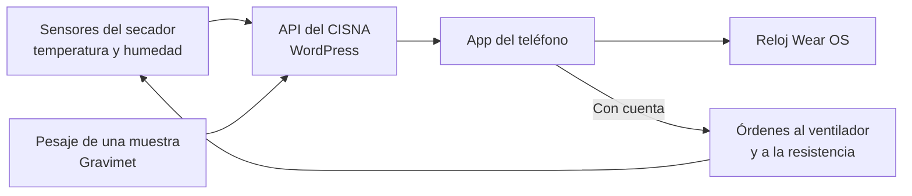
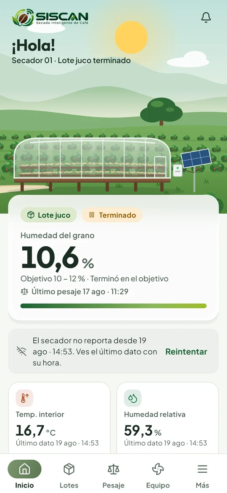
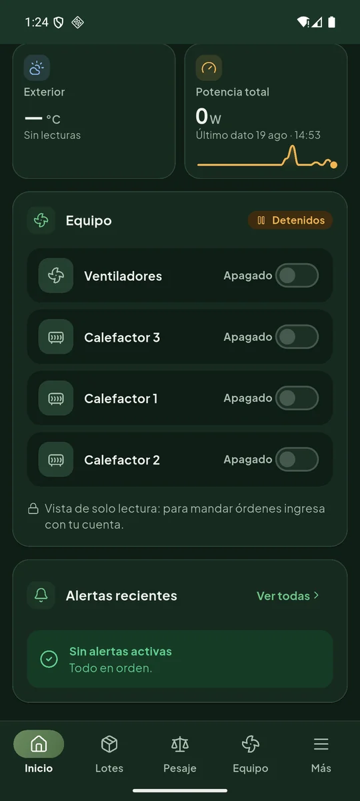
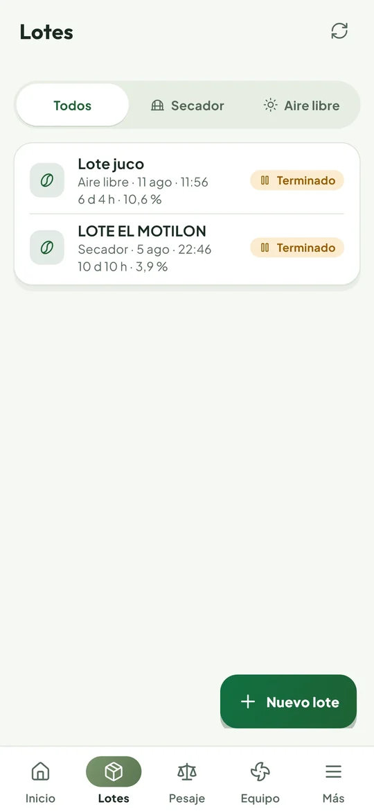
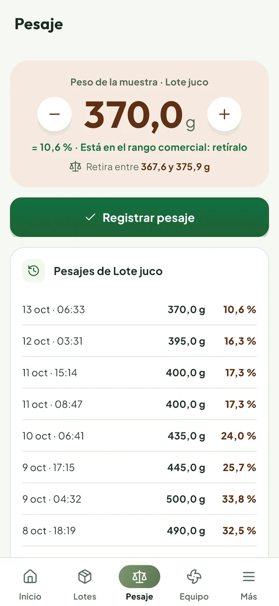
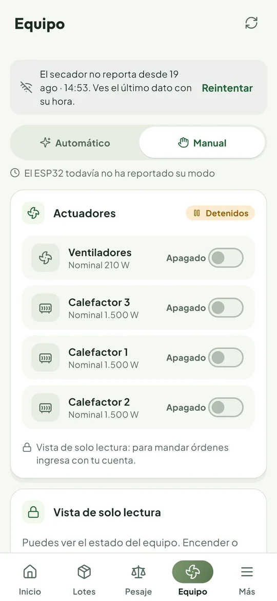
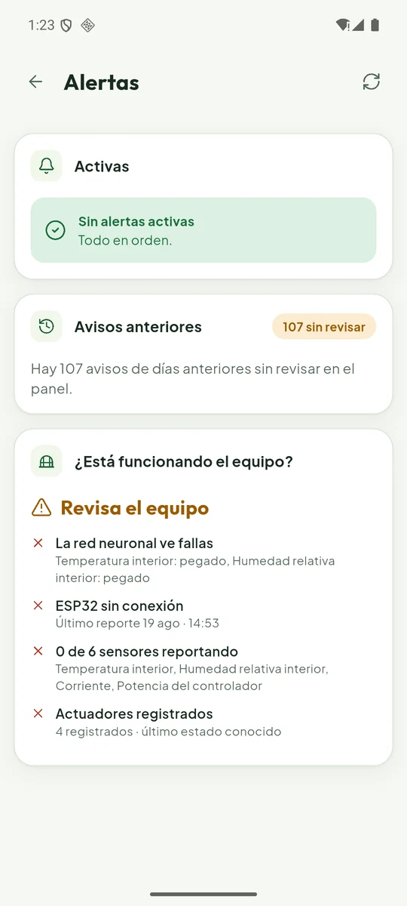
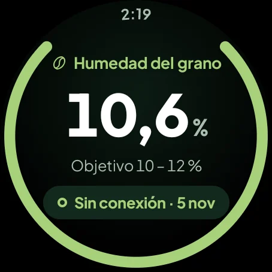
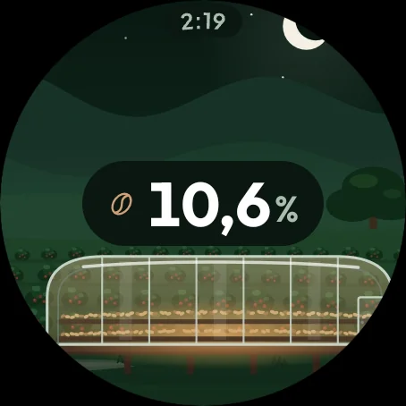

<div align="center">


# SISCAN

**Secado Inteligente de Café**

El secador de café en el bolsillo y en la muñeca. Cuánta humedad le queda al grano,<br/>
cuánto falta para sacarlo y si el equipo está funcionando, sin estar al pie del secador.


[Descargar APK](https://github.com/diarpicu2022-commits/siscan-movil/releases) · [Cómo se usa](#cómo-se-usa) · [Cuentas de prueba](https://github.com/diarpicu2022-commits/mi-portafolio/blob/feat/portfolio-foundation/docs/Cuentas%20de%20prueba.md) · [Portafolio](https://mi-portafolio-beta-kohl.vercel.app)

</div>

---

## La idea

El café pergamino se tiene que secar hasta quedar entre **10 y 12 %** de humedad. Si se pasa o se queda corto, pierde calidad y precio, y el caficultor no puede estar todo el día mirando el secador. SISCAN es la app del secador solar-eléctrico que construí en mi trabajo de grado de Ingeniería Electrónica, en el CISNA de la Gobernación de Nariño.

En el ensayo de agosto de 2026, el lote «juco» secado al aire libre bajó de **44,4 % a 10,6 %** en 12 pesajes. Esa es la cifra que la app pone primero.



## Capturas

<div align="center">

| Inicio | Inicio (oscuro) | Lotes | Pesaje |
|:---:|:---:|:---:|:---:|
|  |  |  |  |
| **Equipo** | **Alertas** | **Reloj · humedad** | **Reloj · escena** |
|  |  |  |  |

</div>

## Qué hace

### Ver el secado de un vistazo

- **Inicio** muestra el lote que se está secando con su humedad, la temperatura, el tiempo que falta y una escena del secador que cambia con la hora del día.
- **Predicción de IA** del tiempo que falta para llegar a la humedad objetivo, con el modelo de la tesis.
- **Curva de secado** de cada lote con todos sus pesajes.

### Registrar y controlar

- **Pesaje** registra una muestra pesada y calcula la humedad. También calibra el Gravimet.
- **Equipo** dice si el secador está funcionando, cuánta energía gasta y cuánto cuesta, y deja mandar órdenes al ventilador y a la resistencia.
- **Alertas** avisa cuando un sensor deja de reportar o cuando algo no cuadra, y responde la pregunta «¿está funcionando el equipo?».

### Fuera de la app

- **Widgets** de inicio y de bloqueo con la humedad, la temperatura, el tiempo restante y la alerta más grave. El ventilador se puede prender desde el widget, la resistencia no.
- **Notificaciones** de alerta.
- **Reloj Wear OS** con la humedad, el tiempo que falta y la alerta, más una tarjeta, cuatro complicaciones y una esfera propia.

### Para usarla en el patio

- Tres temas, **Claro**, **Oscuro** y **Según la hora**, que cambia solo entre el día y la noche.
- **Ingreso con huella** después de la primera vez.
- **Español, inglés y portugués de Brasil**, en el teléfono y en el reloj.

## Cómo se usa

| | Sin cuenta | Con cuenta |
|---|---|---|
| Ver humedad, lotes, curva, predicción y alertas | Sí | Sí |
| Registrar pesajes | No | Sí |
| Mandar órdenes al secador | No | Sí |

La cuenta es un usuario del WordPress del CISNA (`cisna.narino.gov.co`) con una **contraseña de aplicación**. Es distinta de la contraseña normal, solo sirve para SISCAN y se puede revocar desde el perfil de WordPress. Las órdenes llegan al secador de verdad, por eso las cuentas se dan solo a quien las va a usar.

## Instalar

1. Descarga el APK desde [**Releases**](https://github.com/diarpicu2022-commits/siscan-movil/releases).
2. Ábrelo en el teléfono. Android pide **permitir instalar apps de esta fuente**, y hay que aceptarlo.
3. Abre **SISCAN**. Sin cuenta ya se ven los datos en vivo.
4. Para el reloj, instala el APK del reloj en un Wear OS 3 o superior emparejado con el mismo teléfono.

> En Releases está la versión 0.1.1. La actual del código es la 0.2.1.

## Compilar desde el código

**Requisitos:** Flutter con Dart 3.13 o superior, y para el reloj el SDK de Android con JDK 21.

```bash
git clone https://github.com/diarpicu2022-commits/siscan-movil.git
cd siscan-movil/siscan_app
flutter pub get
flutter run                      # en el teléfono conectado o el emulador
flutter test                     # pruebas de pantallas
flutter build apk --release      # APK de release

cd ../siscan_reloj
./gradlew assembleRelease        # app del reloj y esfera
```

> En Windows clona el repo en una ruta sin «ñ» ni tildes (por ejemplo `C:\dev\siscan`), porque el analizador de Dart falla con esos caracteres en la ruta.

La app usa por defecto la API del CISNA. Para apuntar a otra se compila con `--dart-define=SISCAN_API=<url>`.

## Stack

| Capa | Tecnología |
|---|---|
| App del teléfono | Flutter, `flutter_localizations` + `intl` |
| Sesión | Contraseña de aplicación de WordPress, guardada con `flutter_secure_storage` y huella con `local_auth` |
| Widgets y tareas | `home_widget`, `workmanager`, `flutter_local_notifications` |
| Puente con el reloj | `PuenteReloj.kt` (canal nativo, cabecera cifrada con Android Keystore) |
| Reloj | Kotlin, Compose para Wear OS, Tiles, complicaciones y Watch Face Format v2 |
| Servidor | Plugin `secador-cafe-api` de WordPress en el CISNA (vive en el repo de la tesis) |

```
siscan-movil
├── siscan_app/
│   └── lib/
│       ├── pantallas/   inicio, lotes, pesaje, equipo, alertas, más, ingreso
│       ├── data/        API, sesión, estado y puente con el reloj
│       ├── core/        tema y tokens del sistema de diseño
│       └── l10n/        español, inglés y portugués
├── siscan_reloj/        app de Wear OS y esfera
├── docs/
│   ├── ux/anexos/       decisiones de diseño y su verificación
│   └── legal/           política de tratamiento de datos
└── siscan-design-system.zip
```

## Cómo lo diseñamos

SISCAN tiene su propio sistema de diseño (v2), pensado para leerse al sol y con las manos ocupadas, con cifras grandes, los verdes del café y contraste alto. Los tokens están en `siscan_app/lib/core/theme/siscan_tokens.dart`. Cada pieza pasó por investigación de referentes, propuestas, una elegida y verificación medida en el teléfono y en el reloj.

| Anexo | De qué trata |
|---|---|
| `2026-10-08-apk-siscan-sistema-v2.md` | La app del teléfono con el sistema v2 |
| `2026-10-09-reloj-siscan-sistema-v2.md` | El reloj, la tarjeta, las complicaciones y la esfera |
| `2026-10-12-invernadero-y-tema-por-hora.md` | La escena del secador y el tema «Según la hora» |
| `2026-10-15-idiomas.md` | Español, inglés y portugués |

## Datos personales

- La app guarda en el teléfono solo lo necesario para la sesión, cifrado.
- La ubicación se pide solo si tocas «Usar mi ubicación» para ubicar el secador en el mapa, y antes de pedir el permiso la app explica para qué es.
- No hay rastreo ni publicidad.
- La política de tratamiento de datos (Ley 1581 de 2012) está dentro de la app, en «Tus datos», y en `docs/legal/`, en español, inglés y portugués.

Es un borrador técnico y la tiene que revisar un abogado antes de publicar la app en una tienda.

## Hoja de ruta

- Publicar en Releases los APK de la versión 0.2.1 (teléfono, reloj y esfera).
- Probar el reloj con el teléfono en dispositivos reales.
- Instalar el medidor AC para que la energía deje de ser estimada.
- Cambiar la sonda de humedad del grano, que hoy está saturada. Por eso la humedad sale de los pesajes.

---

<div align="center">

Proyecto final de **Diseño de Interfaces de Software** · 5.º semestre · Universidad Cooperativa de Colombia<br/>
App del trabajo de grado de Ingeniería Electrónica · CISNA, Gobernación de Nariño

Hecho por **Diego Armando Pinta Cuasquen** · [GitHub](https://github.com/diarpicu2022-commits) · [Portafolio](https://mi-portafolio-beta-kohl.vercel.app)

</div>
